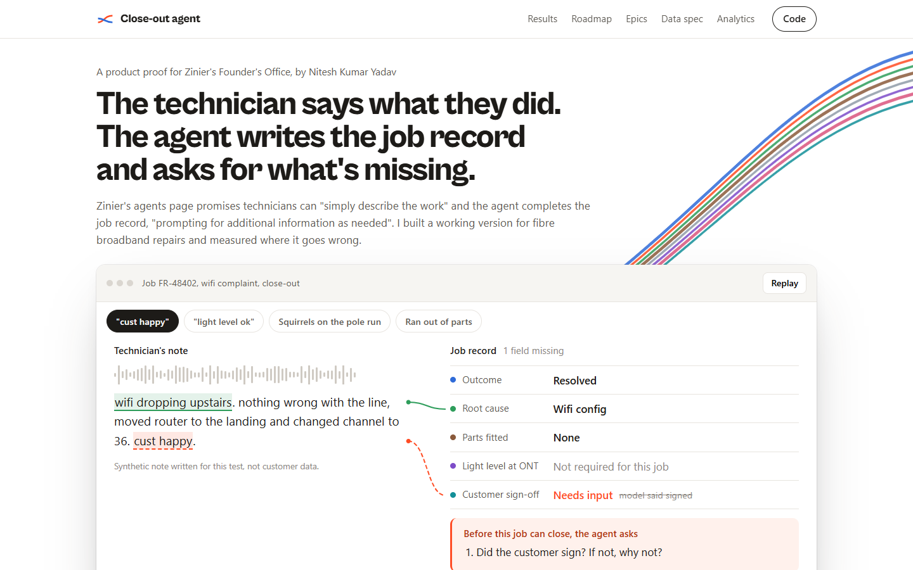

# Close-out agent for field technicians



**Try it live: https://zinier-closeout-agent.vercel.app**

## The problem

Zinier's [agents page](https://www.zinier.com/platform/intelligence/agents) says technicians can "simply describe the work they carried out" and the agent "completes the job record in the approved format, prompting for additional information as needed". The hard part of that promise is the last bit. A model that fills every field looks great in a demo, but if it fills a light level or a customer sign-off that the technician never said, that guess lands in SLA and billing reports, and nobody asks the technician for the real value.

## What I built

- A close-out agent for fibre broadband repair jobs: free-text note in, job record out (outcome, root cause, parts with quantities, light level at the ONT, customer sign-off, revisit reason).
- A grounding check in plain code after the model: any value without supporting words in the note is cleared and turned into a question for the technician.
- A required-field policy per outcome that decides what is missing. It is the same function for every system tested.
- 112 synthetic, hand-labelled technician notes. 32 of them (the holdout) were written only after the rules baseline was frozen in git (commit `4914d7f`), in other technicians' vocabulary.
- The product side of the job: roadmap, Jira-style epics with acceptance criteria, data spec, event schema and analytics plan. All on the live page.

## Result

| Notes | System | Records fully correct | Missing fields caught | Wrong questions | Invented values |
|---|---|---|---|---|---|
| Holdout (32) | Rules baseline | 9 / 32 | 10 / 12 | 24 | 1 |
| Holdout (32) | LLM only | 25 / 32 | 11 / 12 | 0 | 3 |
| Holdout (32) | LLM + grounding check | 21 / 32 | 12 / 12 | 0 | 0 |
| First 80 | Rules baseline | 61 / 80 | 26 / 28 | 5 | 4 |
| First 80 | LLM only | 68 / 80 | 25 / 28 | 3 | 5 |
| First 80 | LLM + grounding check | 71 / 80 | 26 / 28 | 3 | 2 |
| All 112 | Rules baseline | 70 / 112 | 36 / 40 | 29 | 5 |
| All 112 | LLM only | 93 / 112 | 36 / 40 | 3 | 8 |
| All 112 | LLM + grounding check | 92 / 112 | 38 / 40 | 3 | 2 |

**Key finding.** On the 32 holdout notes the rules extractor got 9 records fully right and the model alone got 25, but the model also invented 3 values no note states (for example a sign-off from "customer satisfied"). The grounding check removed all of them and caught 12 of 12 missing fields. Its own word list was too narrow for new words like "gateway" and "sleeve", though, so it cleared 7 correct parts and fully correct records fell to 21. So the product design is: ground only the fields where a guess does harm (light level, sign-off), and check parts against van stock instead of a word list.

Model: gemini-3.5-flash-lite (Gemini free tier), temperature 0, median 2.07 s per call.

## Run it

```
cd eval
python dataset.py                 # writes tickets.json
GEMINI_API_KEY=... CLOSEOUT_MODEL=gemini-3.5-flash-lite python agent.py   # free tier, cached in results/llm_raw.json
python score.py                   # writes results/summary.json and per_ticket.json
python build_site_data.py         # writes site/data.js (the page needs no key)
```

The raw model output for every note is committed in `eval/results/llm_raw.json`, so scores can be checked without an API key.

## Honest limits

- All notes are synthetic. I wrote and labelled them to look like real fibre repair notes; they are not customer data.
- I wrote the rules baseline too. That is why the holdout exists, and why the rules score much better on the first 80 notes than on the holdout.
- One model, one run, temperature 0. The grounding check is simple keyword and number matching, so it can also clear a correct value.

## Files

- `eval/dataset.py` notes, labels and the required-field policy
- `eval/rules.py` rules baseline
- `eval/agent.py` prompt, Gemini call, grounding check
- `eval/score.py` metrics
- `site/` the live page (static HTML, CSS, JS)
- `DESIGN_NOTES.md` design direction

Built by Nitesh Kumar Yadav, final-year B.Tech ECE (AI and ML), NSUT Delhi.
